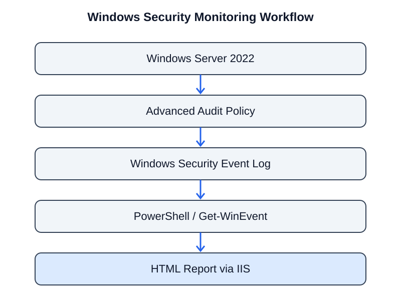

# Windows Security Monitoring and Event Log Reporting Lab

> A Windows Server 2022 lab for configuring audit policies, reviewing Security events, collecting logs with PowerShell, and presenting selected event data in an HTML report.

[](#lab-environment)
[](#workflow)
[](#workflow)



## Project overview

This project demonstrates a basic Windows security monitoring workflow in a virtualized lab. I configured Windows audit policies, reviewed recorded events in Event Viewer, used PowerShell to retrieve and filter Security log entries, and generated an HTML report for browser-based review.

The exercise focused on understanding how Windows auditing works and how event data can be collected for investigation and reporting. It is a foundational host-monitoring lab, not a production SIEM deployment.

## Lab environment

| Component | Role |
|---|---|
| Oracle VirtualBox | Virtualization |
| Windows Server 2022 | Monitored system |
| Microsoft Management Console (MMC) | Management console |
| Local Group Policy Editor | Audit policy configuration |
| Windows Event Viewer | Security log review |
| Windows PowerShell / PowerShell ISE | Event retrieval and reporting |
| Internet Information Services (IIS) | Local web presentation of report |
| Windows Defender Firewall | Inbound TCP rule for the report endpoint |

## Workflow

### 1. Prepare Windows Server

Created a Windows Server 2022 virtual machine in Oracle VirtualBox and prepared it for audit-policy configuration and event monitoring.

### 2. Configure audit policies

Opened Microsoft Management Console and added the Group Policy Object Editor snap-in for Local Computer Policy.

Navigated to:

`Computer Configuration → Windows Settings → Security Settings → Advanced Audit Policy Configuration → System Audit Policies`

Configured selected audit categories and subcategories, including Account Logon, Detailed Tracking, Logon/Logoff, Object Access, Privilege Use, and System. The recorded settings included Credential Validation, Other Account Logon Events, Process Creation, Logon, Special Logon, Registry, and System Events. Success and Failure auditing were enabled for the selected Account Logon subcategories.

### 3. Configure file-system and PowerShell auditing

Configured Global Object Access Auditing for the File System using the Everyone principal in the lab. Enabled PowerShell Module Logging through Administrative Templates. The original notes also mention changing the script execution policy; execution policy is not a security boundary and should not be treated as a replacement for application control or script monitoring.

### 4. Apply policy changes

Refreshed policy using:

```powershell
gpupdate /force
```

This requests an immediate Group Policy update on the system.

### 5. Review events in Event Viewer

Opened:

`Event Viewer → Windows Logs → Security`

Used Filter Current Log to review selected event IDs. The original lab notes specifically mention Event ID **4689**, which records process termination. It is not a successful-logon event. This distinction matters when interpreting Windows telemetry.

For a focused logon-monitoring extension, review Event ID **4624** for successful logons and **4625** for failed logons, provided the relevant audit policy is enabled and the events are present in the lab.

### 6. Retrieve events with PowerShell

Used `Get-WinEvent` in PowerShell ISE to retrieve Security log entries and filter the results rather than reviewing the entire log manually. The notes identify a script named `login_info.ps1` for working with logon information.

Example read-only query for successful and failed logons:

```powershell
Get-WinEvent -FilterHashtable @{
    LogName = 'Security'
    Id      = 4624, 4625
} -ErrorAction SilentlyContinue |
Select-Object TimeCreated, Id, ProviderName, Message
```

This example illustrates event retrieval; it does not assert that the original script used this exact query.

### 7. Generate a browser-viewable report

Installed the IIS Web Server role. Configured a Windows Defender Firewall inbound rule for TCP port 8080 and used the reporting script named `reports.ps1` to export selected Windows Security log information to HTML.

Opened the generated report in a browser to review the collected event data in tabular form.

## Monitoring workflow

```text
Windows Server 2022
        |
        v
Advanced Audit Policies
        |
        v
Windows Security Event Log
        |
        +------> Event Viewer (manual review)
        |
        v
PowerShell / Get-WinEvent
        |
        v
HTML report (reports.ps1)
        |
        v
Browser review through IIS
```

## Skills demonstrated

- Windows audit-policy configuration using Local Group Policy.
- Reviewing Security events with Event Viewer.
- Understanding Windows event IDs and their meanings.
- Retrieving and filtering event data with PowerShell.
- Generating an HTML event report.
- Configuring IIS and a Windows Firewall inbound rule in a lab.

## Important event-ID note

| Event ID | Meaning |
|---|---|
| 4624 | Successful logon |
| 4625 | Failed logon |
| 4689 | Process termination |

Event availability and detail depend on audit policy, Windows version, and the activity being recorded. Do not infer an account compromise from an event ID alone; correlate account, logon type, source address, timestamp, host, and surrounding activity.

## Evidence and limitations

The project notes identify the environment, configuration areas, scripts, and reporting workflow. The repository currently contains no PowerShell script files, sample HTML report, screenshots, or sanitized event exports. The script names are therefore documented as project components, not linked as downloadable source artifacts.

For a stronger portfolio, add the actual scripts, a redacted sample report, screenshots of the configured audit policies, and sanitized event samples. Review the scripts before publishing and remove usernames, machine names, IP addresses, and other sensitive details.

## Responsible use

This is a learning lab. Apply audit policy and firewall changes only on systems you administer or are authorized to test. Avoid exposing Security log data or HTML reports to untrusted networks.

## Author

**Naga Venkata Eswara Sastry L**  
Cybersecurity learner | Aspiring SOC Analyst

